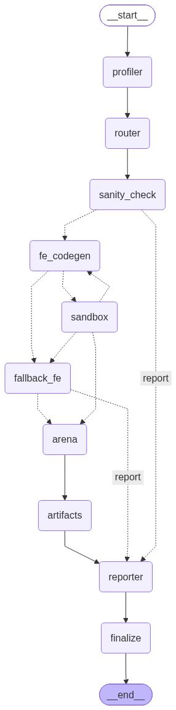

# auto-ds-agent

An agent that ingests a tabular dataset, infers the ML task, writes and self-repairs
feature engineering code in a sandbox, benchmarks candidate models, and recommends the
best pipeline with a written justification.

**Core principle: the LLM makes judgments, Python does the computation.** Every metric,
statistic, and training run is deterministic. The LLM is confined to three nodes —
task routing, feature-engineering codegen, and the final report.

Status: **Phase 5 of 8 — the agent runs end to end from a CSV to a ranked model
leaderboard** (profiling, task routing, self-repairing feature engineering, fallback,
cross-validated model arena). The written report and CLI (Phase 6) are next.

See `PROJECT_PLAN.md` for the full architecture and phase breakdown.

## Architecture



Dashed arrows are decisions made in code by reading the shared state:

- **sanity_check → end** when there is no supported task (profiling failed, or the task is
  out of scope, e.g. time-series forecasting).
- **fe_codegen → sandbox → fe_codegen** is the corrective loop: the LLM writes feature
  engineering code, a sandboxed subprocess runs and validates it, and on failure the error
  goes back to the LLM. At most 3 attempts, enforced by the graph, not the prompt.
- **→ fallback_fe** after 3 failures, or if the LLM cannot be reached: a deterministic
  pandas recipe, so the run degrades instead of failing.
- **→ arena** once features exist: six models (a dummy baseline, a linear model, random
  forest, HistGradientBoosting, XGBoost, LightGBM) are cross-validated on the same five
  folds. The best mean wins only if it beats every simpler model on at least 4 of 5 folds;
  otherwise the simpler model wins. Given the same features, the leaderboard is identical
  on every run. (The generated feature code itself can vary between runs: current LLMs do
  not accept temperature 0.)

The diagram is generated from the code (`uv run python scripts/render_graph.py`); a test
fails if `docs/graph.mmd` no longer matches the graph.

## Usage

```bash
uv sync
cp .env.example .env          # then set OPENAI_API_KEY
uv run autods run datasets/Titanic-Dataset.csv --description "Predict who survived"
```

Each run gets its own folder under `runs/` with `report.md`, `leaderboard.csv`,
`best_pipeline.joblib`, `fe_code.py` and `run.json`. `--target` names the column to predict
(otherwise it is inferred); `--verbose` shows detailed logs. Exit codes: `0` a model was
recommended, `2` bad command line, `3` the run ended without a model (the report says why).

## Development

```bash
uv sync
uv run pytest
uv run ruff check src/ --fix
```

## Known limitations

- **The sandbox is isolation, not security.** Generated code runs in a separate process with
  a timeout, a stripped environment (no API keys), an import allowlist and, on Linux/macOS, a
  memory cap. It still shares the filesystem and network with the host; real security needs a
  container. The import check stops accidental harm, not a determined adversary.
- **Generated feature code is batch-stateless.** It computes medians and categories from
  whatever frame it receives, so `best_pipeline.joblib` is for re-scoring batches (run
  `fe_code.py`, then align to the saved `feature_columns`), not single-row serving.
- **Only load `best_pipeline.joblib` files you created.** Like any pickle-based format,
  loading one executes code.
- **Feature code can differ between runs.** Current LLMs do not accept temperature 0. Given
  the same features, the model arena's results are identical on every run.

## Out of scope (v1)

Deep learning · NLP · computer vision · time series forecasting · multi-table joins ·
distributed training · exhaustive hyperparameter optimization.
